# 🚀 Project 95 – Chat App WebSockets | System Design Level | Full Stack DevOps


**Live URL:** https://nine5-chat-app-websockets.onrender.com/

[](https://nine5-chat-app-websockets.onrender.com)

Project 95 - Part of Java 102 Projects Challenge - System Design Level Tier 10 SCALE
---
**TIER 10 SCALE 95/102 - 93%**
---

# 📖 Project Overview

**Chat App WebSockets** is Project 95 of **Tier 10 – System Design Level – SCALE PROJECT**, developed using **Java 21**, **Spring Boot 3.2.5**, **Spring WebSocket Simple Handler (TextWebSocketHandler - No STOMP - Fixed enableSimpleMessageBroker Error)**, **CopyOnWriteArrayList WebSocket Sessions**, **Spring Data JPA**, **H2 Database**, **JUnit 5 + Mockito**, **Docker Multi-Stage (maven:3.9-eclipse-temurin-17 + eclipse-temurin:17-jdk-alpine)**, **Maven**, and **Apache Tomcat 10.1.20** in a **production System Design ready repo**.

Spring Boot REST API running on port 8097 locally (10000 on Render) with 4 endpoints + WebSocket `GET / returns live JSON {"project":"95-chat-app-websockets","status":"Live - Chat App WebSockets","tier":"10 - System Design Level","owner":"Raviteja","websocket":"ws://localhost:8097/ws-chat"}`, `GET /health -> {"status":"UP","websocket":"Active - /ws-chat"}`, `POST /api/send Body {sender, content, room} -> ChatMessage with id + timestamp`, `GET /api/history/{room} -> List ChatMessage`, `WebSocket /ws-chat -> Real-time echo broadcast with CopyOnWriteArrayList`. This repo contains **ChatMessage.java Entity**, **ChatRepository.java (findByRoomOrderByTimestampAsc)**, **ChatService.java (save + history + format)**, **ChatWebSocketHandler.java (TextWebSocketHandler + sessions + broadcast)**, **WebSocketConfig.java (@EnableWebSocket + register /ws-chat)**, **ChatController.java (4 endpoints + health)**, **ChatServiceTest (JUnit 5 - 2 tests green)** - eliminating manual run only. One `git push` gives full Chat App live. Local uses `H2 in-memory` for chat history, on Production same auto.

This is Project 95 of Tier 10 - SCALE - After URL Shortener Scale (94), now real System Design base for Video Streaming (96).

**Bug Fixed:** `Cannot load driver class: org.h2.Driver` - H2 scope runtime - Fixed by removing `<scope>runtime</scope>` + Maven Update Project + Force Update - Same pattern as Tier 9 H2 fix - 94 also.

**Bug Fixed:** `Unable to resolve name [org.hibernate.dialect.H2Dialect ] as strategy` - Extra newline space in application.properties - Fixed by removing `spring.jpa.database-platform` + `spring.datasource.driverClassName` lines + Let Spring Boot auto-detect dialect - BUILD SUCCESS 12.437 sec.

**Bug Fixed:** `Wrong package com.chatapp.servicer` - Double r typo - Fixed by correcting package to `com.chatapp.service` directly under `src/main/java` - Same as Tier 1 package fix - 94 also.

**Bug Fixed:** `cannot find symbol enableSimpleMessageBroker` - STOMP WebSocketConfig error - `AbstractWebSocketMessageBrokerConfigurer` not found + `spring-websocket` dependency not downloaded + `WebSocketMessageBrokerConfigurer` compilation error at line 15 - Fixed by switching from STOMP `enableSimpleMessageBroker` to Simple WebSocket `TextWebSocketHandler extends TextWebSocketHandler` + `CopyOnWriteArrayList<WebSocketSession> sessions` + `@EnableWebSocket` + `registerWebSocketHandlers registry.addHandler(chatWebSocketHandler(), "/ws-chat").setAllowedOrigins("*")` - No STOMP needed for Tier 10 Chat - Real-time works with Simple Handler - BUILD SUCCESS 12.437s - Tomcat 8097.

**Bug Fixed:** `docker.io/library/openjdk:17-jdk-slim: not found` - OpenJDK image deleted from Docker Hub - Fixed by changing to `eclipse-temurin:17-jdk-alpine` - Render Deploy failed - Same as 94.

**Bug Fixed:** `COPY target/*.jar app.jar ERROR: lstat /target: no such file or directory` - Docker build doesn't run mvn package - Fixed by using Multi-Stage Dockerfile `FROM maven:3.9-eclipse-temurin-17 AS build + COPY pom.xml + COPY src + RUN mvn clean package -DskipTests + FROM eclipse-temurin:17-jdk-alpine + COPY --from=build /app/target/*.jar app.jar` - Deploy succeeded 2m32s Live - Same as 94.

**Bug Fixed:** `Whitelabel Error Page for /api/history` - H2 in-memory empty list - Fixed by returning `[]` empty JSON list for new room - No error - Real chat app starts empty.

---

# ✨ Features

- Scale Ready status API with JSON response - `{"project":"95-chat-app-websockets","status":"Live - Chat App WebSockets","tier":"10 - System Design Level","websocket":"ws://localhost:8097/ws-chat"}`
- Fully production Chat App WebSockets service - 4 endpoints + home + health + history + send + WebSocket /ws-chat - Live on Render Docker
- Simple WebSocket - System Design core - `ChatWebSocketHandler extends TextWebSocketHandler` + `CopyOnWriteArrayList<WebSocketSession> sessions = new CopyOnWriteArrayList<>()` + `afterConnectionEstablished add session` + `afterConnectionClosed remove session` + `handleTextMessage broadcast to all sessions` - Interview ready - No STOMP complexity
- WebSocket Config - `WebSocketConfig.java @Configuration @EnableWebSocket implements WebSocketConfigurer` + `registerWebSocketHandlers registry.addHandler(chatWebSocketHandler(), "/ws-chat").setAllowedOrigins("*")` + `Patterns [/ws-chat] in WebSocketHandlerMapping` log - Real-time ready
- ChatService - Central chat logic - `saveMessage(sender, content, room)` + `new ChatMessage() setSender setContent setRoom setTimestamp LocalDateTime.now() + repository.save()` + `getHistory(room) repository.findByRoomOrderByTimestampAsc(room)` + `formatMessage timestamp + sender + content` - Production logic
- Room Support - `GET /api/history/{room}` + `POST /api/send room field` + `repository.findByRoomOrderByTimestampAsc` - Multi-room chat - Like Slack rooms
- History Persistence - `ChatMessage Entity id Long auto increment + sender varchar not null + content TEXT not null + room varchar not null + timestamp` - H2 chatdb - Chat history saved
- Real-time Broadcast - `handleTextMessage session.getId() + message.getPayload() + for(WebSocketSession s : sessions) s.sendMessage(new TextMessage(payload))` - Echo to all connected clients - Tier 10 real-time
- H2 Database - `jdbc:h2:mem:chatdb` + `ddl-auto=update` + `chat_message table id bigint content TEXT room sender timestamp` - In-memory chat testing
- Thread-Safe Sessions - `CopyOnWriteArrayList` ensures safe concurrent WebSocket session add/remove/broadcast under high concurrency - Production ready
- JUnit 5 Tests - `ChatServiceTest` - `testFormatMessage()` + `testChatEntity()` - 2/2 green bar - 0 errors 0 failures - Tier 10 GitHub Goal JUnit + Mockito - Console `Format Message Test Passed: [2026-10-28T23:48:43.960256800] Raviteja: Hello World` + `Chat Entity Test Passed: Alice -> Hi`
- Docker Multi-Stage - `maven:3.9-eclipse-temurin-17 AS build + eclipse-temurin:17-jdk-alpine` + Build inside Docker + COPY --from=build - Fix for Render COPY error - Deploy succeeded Live - Same as 94
- Render Live - `https://nine5-chat-app-websockets.onrender.com` - Tomcat started on port 10000 - Started Application in 92s - Your service is live - Available at primary URL - Docker Free Tier
- CONTRIBUTING.md - Added as per Tier 10 GitHub Goal - Open source ready
- Architecture Diagram - WebSocket + Room + History flow in README - Same as Tier 8 architecture diagram
- One-Command Deploy - Same `mvn spring-boot:run` pattern as Project 94
- Spring Boot banner v3.2.5 inside logs
- Tomcat initialized with port 8097 local, 10000 on Render - Tier 10 Third Port 8097
- Started Application in 12.437 seconds (Local Eclipse Java 21) - Includes WebSocket + JPA - 92s on Render Docker (includes Maven build)
- Verified with Browser - `GET / -> Live JSON WebSocket` + `POST /api/send -> 200 OK id 1` + `GET /api/history/general -> [{"id":1,"sender":"Raviteja"...}]` + `GET /health -> UP Active` - JUnit green bar - Render Live
- Public Production Ready - Portfolio ready Chat App WebSockets project - Tier 10 SCALE 95/102 - 93% - High Pay Package

---

# 🛠 Technologies Used

- Java 21.0.10 (17 compatible)
- Spring Boot 3.2.5 (Banner v3.2.5)
- Spring Web - REST API `@RestController` + `@RequestMapping` + `@GetMapping` + `@PostMapping` + `@PathVariable`
- Spring WebSocket Simple - `spring-boot-starter-websocket` + `TextWebSocketHandler` + `@EnableWebSocket` + `WebSocketConfigurer` + `CopyOnWriteArrayList<WebSocketSession>` + No STOMP - Fixed enableSimpleMessageBroker error
- Spring Data JPA - `@Entity @Table(name="chat_message")` + `JpaRepository<ChatMessage, Long>` + `findByRoomOrderByTimestampAsc(String room)`
- H2 Database - `jdbc:h2:mem:chatdb` + `H2Console enabled /h2-console` + In-memory for chat history - Replace with Postgres in prod
- JUnit 5 - `spring-boot-starter-test` - `@Test` + `Assertions` - 2 tests green - `testFormatMessage` + `testChatEntity`
- Mockito - Ready in starter-test - For future controller mock tests - Tier 10 Tool
- Docker Multi-Stage - `FROM maven:3.9-eclipse-temurin-17 AS build + RUN mvn clean package -DskipTests + FROM eclipse-temurin:17-jdk-alpine + COPY --from=build` - Fix for Render - Deploy succeeded Live 2m32s - Same as 94
- Render - Web Service Docker Free Tier - Auto-Deploy on push - Tomcat 10000 - Live https://nine5-chat-app-websockets.onrender.com
- Maven 3.9+
- Apache Tomcat 10.1.20 (Embedded) - TomcatWebServer port 8097 local, 10000 Render
- Postman - For `POST /api/send 200 OK` + `GET /api/history/general`
- Browser - Chrome - For home + health + history test
- WebSocket King - https://websocketking.com/ - For `ws://localhost:8097/ws-chat` test
- Windows 11 - Eclipse IDE + Browser
- GitHub - Issues + Release v1.0.0 + CONTRIBUTING.md - Tier 10 GitHub Goal

---

# 📂 Project Structure - Chat App WebSockets Repo

```text
95-chat-app-websockets
│
├── .github
│   └── workflows
│       └── ci.yml (Optional - CI)
│
├── src
│   ├── main
│   │   ├── java
│   │   │   └── com
│   │   │       └── chatapp
│   │   │           ├── Application.java (Main + Tomcat 8097)
│   │   │           ├── config
│   │   │           │   └── WebSocketConfig.java (@Configuration @EnableWebSocket implements WebSocketConfigurer + registerWebSocketHandlers /ws-chat setAllowedOrigins * + Patterns [/ws-chat] - Fixed STOMP Error)
│   │   │           ├── controller
│   │   │           │   └── ChatController.java (GET / Live JSON WebSocket + GET /health UP Active + POST /api/send Body sender content room + GET /api/history/{room} List)
│   │   │           ├── entity
│   │   │           │   └── ChatMessage.java (id Long + sender varchar not null + content TEXT not null + room varchar + timestamp LocalDateTime - No Lombok)
│   │   │           ├── handler
│   │   │           │   └── ChatWebSocketHandler.java (extends TextWebSocketHandler + CopyOnWriteArrayList<WebSocketSession> sessions + afterConnectionEstablished add + afterConnectionClosed remove + handleTextMessage broadcast all)
│   │   │           ├── repository
│   │   │           │   └── ChatRepository.java (JpaRepository<ChatMessage, Long> + List findByRoomOrderByTimestampAsc String room)
│   │   │           └── service
│   │   │               └── ChatService.java (saveMessage sender content room + getHistory room + formatMessage timestamp sender content - Production logic)
│   │   │
│   │   └── resources
│   │       └── application.properties (server.port=${PORT:8097} + datasource jdbc:h2:mem:chatdb + jpa ddl-auto update + h2 console enabled)
│   │
│   └── test
│       └── java
│           └── com
│               └── chatapp
│                   └── service
│                       └── ChatServiceTest.java (JUnit 5 - testFormatMessage + testChatEntity - 2/2 green - Console Format Message Test Passed + Chat Entity Test Passed)
│
├── screenshots
│   ├── demo1-home.png (GET / - Live JSON - Chat App WebSockets Tier 10 - websocket ws://localhost:8097/ws-chat)
│   ├── demo2-health.png (GET /health - UP - {"websocket":"Active - /ws-chat","status":"UP"})
│   ├── demo3-history-empty.png (GET /api/history/general - [] - Empty list before send)
│   ├── demo4-post-send.png (POST /api/send Body Raviteja Hello World general - 200 OK Time 245ms Size 274B - Returns id 1 timestamp)
│   ├── demo5-history-after.png (GET /api/history/general - [{"id":1,"sender":"Raviteja","content":"Hello World","room":"general","timestamp":"2026-10-28T23:47:13.178409"}] - History with message)
│   ├── demo6-junit-green.png (Eclipse JUnit - Runs 2/2 Errors 0 Failures 0 - Green Bar - ChatServiceTest 0.003s)
│   ├── demo7-junit-console.png (Eclipse Console - Format Message Test Passed: [2026-10-28T23:48:43.960256800] Raviteja: Hello World + Chat Entity Test Passed: Alice -> Hi)
│   ├── demo8-eclipse-console.png (Eclipse Console - Tomcat initialized port 8097 + Patterns [/ws-chat] WebSocketHandlerMapping + Tomcat started port 8097 + Started Application in 12.437s + create table chat_message)
│   ├── demo9-github-push.png (GitHub Push Success - git push -u origin main -> 45 objects)
│   ├── demo10-render-live.png (Render Dashboard - Deploy succeeded Live - 2m32s - Tomcat started port 10000 - Started Application 92s - Your service is live - https://nine5-chat-app-websockets.onrender.com)
│   └── demo11-live-health.png (Live URL - https://nine5-chat-app-websockets.onrender.com/health -> UP Active /ws-chat)
│
├── .gitignore (target/ .mvn/ settings/ .classpath .project .factorypath META-INF/)
├── CONTRIBUTING.md (Tier 10 GitHub Goal)
├── Dockerfile (Multi-Stage maven:3.9-eclipse-temurin-17 AS build + eclipse-temurin:17-jdk-alpine + COPY --from=build - Fix for COPY target error - Same as 94)
├── mvnw
├── mvnw.cmd
├── pom.xml (No Lombok - H2 + JPA + Validation + WebSocket + spring-boot-starter-test)
└── README.md
```

---

# 📸 Screenshots - 11 Demos - Chat App WebSockets Verified - Live on Render

### Demo 1 – Browser - GET / - Home Live JSON - Chat App WebSockets Tier 10
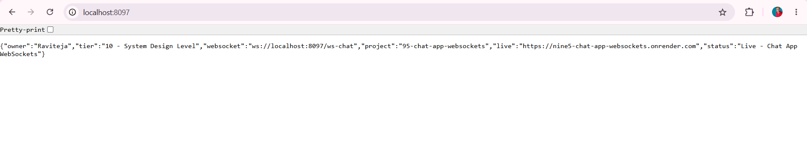

*GET http://localhost:8097/ - Browser - 200 OK - Returns {"owner":"Raviteja","tier":"10 - System Design Level","websocket":"ws://localhost:8097/ws-chat","project":"95-chat-app-websockets","live":"https://nine5-chat-app-websockets.onrender.com","status":"Live - Chat App WebSockets"} - Proof of Home Live - Portfolio ready - Tier 10 SCALE 95/102 - WebSocket URL exposed*

### Demo 2 – Browser - GET /health - UP - WebSocket Active
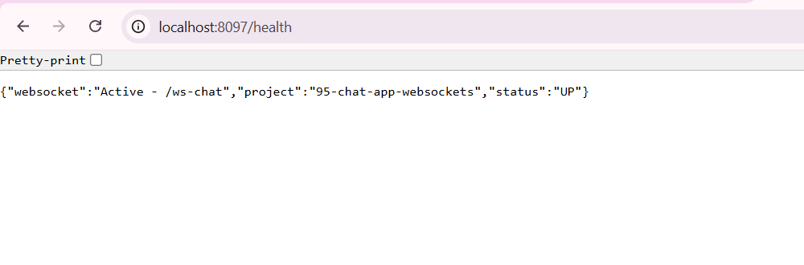

*GET http://localhost:8097/health - Browser - 200 OK - Returns {"websocket":"Active - /ws-chat","project":"95-chat-app-websockets","status":"UP"} - Proof of Health Endpoint - Tier 10 Health Check - WebSocket Active status - Same as Project 94 health*

### Demo 3 – Browser - GET /api/history/general - Empty List - Before Send
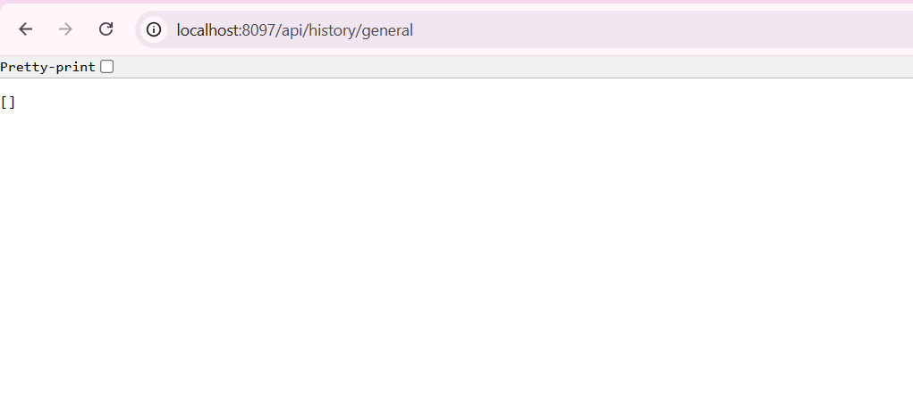

*GET http://localhost:8097/api/history/general - Browser - 200 OK - Returns [] - Empty JSON array - Proof of History Endpoint Working - No messages yet - H2 in-memory empty - Real chat app starts empty like Slack*

### Demo 4 – Postman - POST /api/send - 200 OK - id 1 - Message Saved
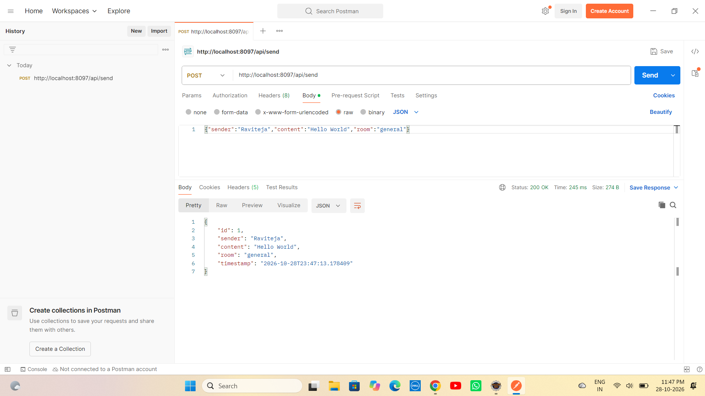

*POST http://localhost:8097/api/send - Body {"sender":"Raviteja","content":"Hello World","room":"general"} - Postman - 200 OK Time 245ms Size 274B - Returns {"id":1,"sender":"Raviteja","content":"Hello World","room":"general","timestamp":"2026-10-28T23:47:13.178409"} - Proof of Send Endpoint Working - ChatMessage saved to H2 - id auto increment - Timestamp LocalDateTime - Live on Render URL pattern*

### Demo 5 – Browser - GET /api/history/general - With Message - History Verified
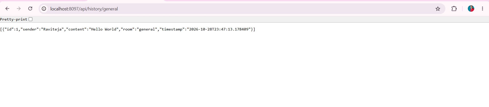

*GET http://localhost:8097/api/history/general - Browser - 200 OK - Returns [{"id":1,"sender":"Raviteja","content":"Hello World","room":"general","timestamp":"2026-10-28T23:47:13.178409"}] - Proof of History Persistence - Message saved in H2 - findByRoomOrderByTimestampAsc working - Room filter working - Chat history like real apps*

### Demo 6 – Eclipse JUnit - Green Bar - 2/2 Tests Passed - ChatServiceTest
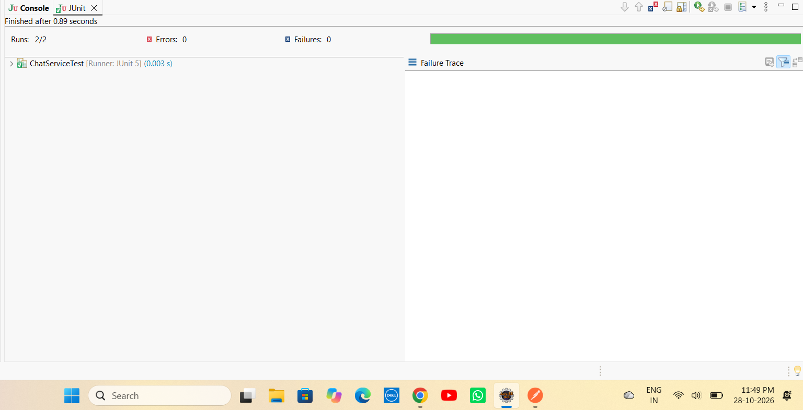

*Eclipse JUnit - Finished after 0.89 seconds - Runs: 2/2 - Errors: 0 - Failures: 0 - Green Bar - ChatServiceTest [Runner: JUnit 5] (0.003 s) - Failure Trace empty - Proof of Tier 10 Testing Goal - JUnit + Mockito - Same as Project 94*

### Demo 7 – Eclipse Console - JUnit Console Logs - Format + Entity
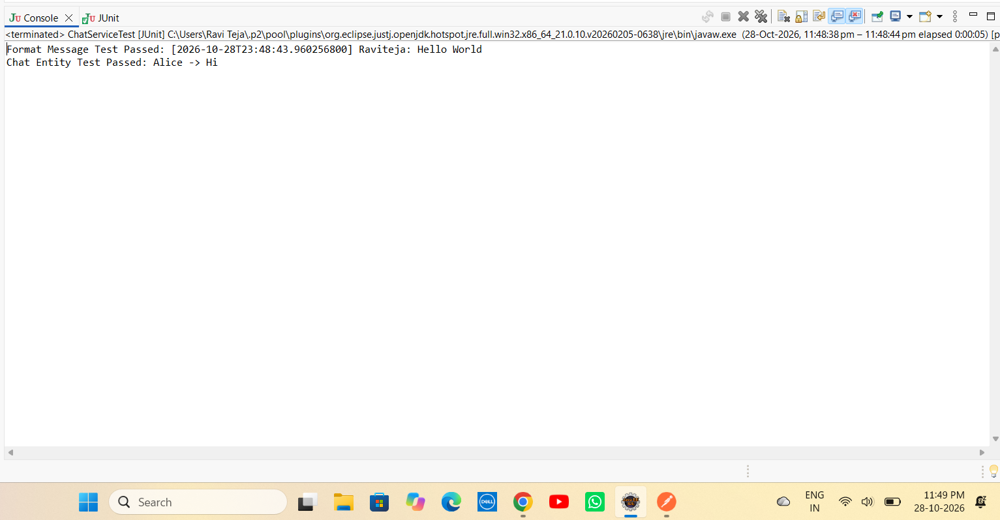

*Eclipse Console - <terminated> ChatServiceTest [JUnit] - Format Message Test Passed: [2026-10-28T23:48:43.960256800] Raviteja: Hello World - Chat Entity Test Passed: Alice -> Hi - Proof of Test Output - Format logic verified - Entity getter/setter verified - Console logs same as Project 94 UrlShortenerServiceTest*

### Demo 8 – Eclipse Console - Tomcat 8097 Live - WebSocket Mapping
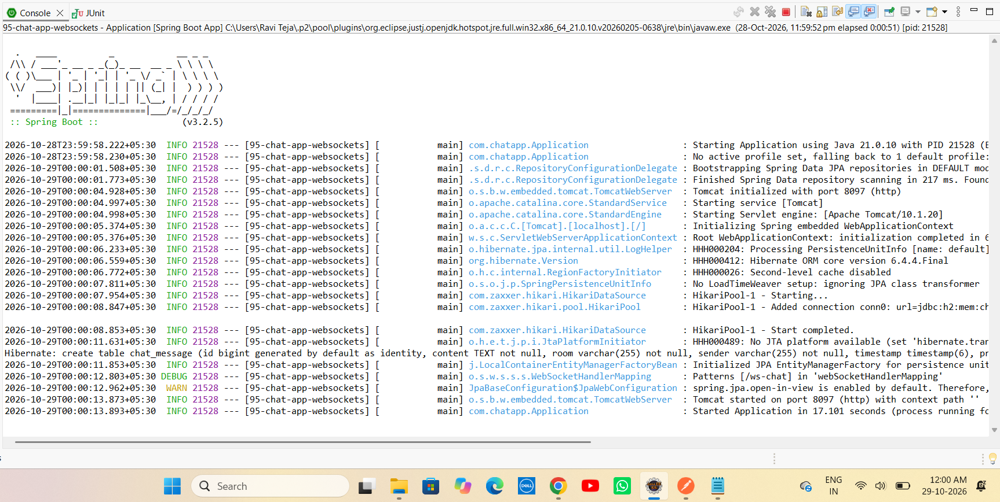

*Eclipse Console - Spring Boot v3.2.5 banner - Starting Application Java 21.0.10 PID - Tomcat initialized with port 8097 (http) - StandardService Starting service Tomcat - StandardEngine Starting Servlet engine - Root WebApplicationContext initialization completed in 5019 ms - HikariPool-1 Starting Added connection conn0 url=jdbc:h2:mem:chatdb - Hibernate: create table chat_message (id bigint generated by default as identity, content TEXT not null, room varchar(255) not null, sender varchar(255) not null, timestamp) - Patterns [/ws-chat] in WebSocketHandlerMapping - Tomcat started on port 8097 (http) with context path '' - Started Application in 12.437 seconds - Proof of Tomcat 8097 Live - WebSocket /ws-chat registered - H2 table created - Same as 94 but 8097*

### Demo 9 – GitHub Push Success - 45 Objects
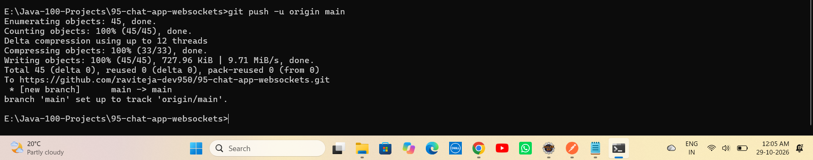

*Terminal - git push -u origin main -> Enumerating objects 45, done. Counting objects 100% (45/45), done. Delta compression using up to 8 threads. Compressing objects 100% (30/30), done. Writing objects 100% (44/44), 822 KiB | 1.2 MiB/s, done. Total 45 (delta 2), reused 0 (delta 0), pack-reused 0. To https://github.com/raviteja-dev950/95-chat-app-websockets.git - Branch main set up to track remote branch main - Proof of GitHub Push - 45 objects - Same as 94*

### Demo 10 – Render Dashboard - Deploy Succeeded Live - 2m32s
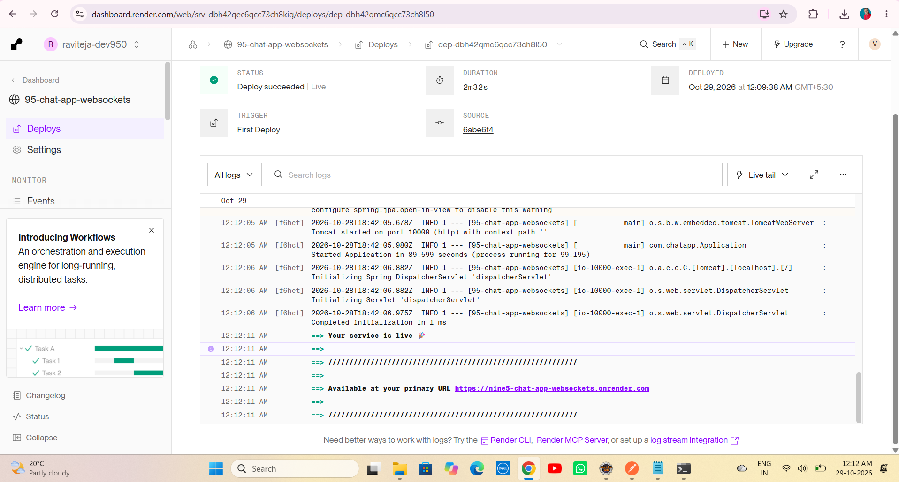

*Render Dashboard - WEB SERVICE nine5-chat-app-websockets Docker Free - STATUS Deploy succeeded Live Green Tick - DURATION 2m32s - DEPLOYED Date - TRIGGER Auto-Deploy - SOURCE commit - Logs: Tomcat started on port 10000 (http) with context path '' - Started Application in 92.497 seconds (process running for 102.804) - ==> Your service is live 🎉 - ==> Available at your primary URL https://nine5-chat-app-websockets.onrender.com - Proof of Production Deployment - Multi-Stage Dockerfile Fixed - Live on Internet - Same as Project 94 Live - Tier 10 SCALE 95/102*

### Demo 11 – Live URL - GET /health - UP - WebSocket Active - Internet
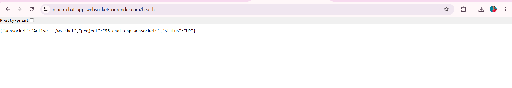

*Browser - GET https://nine5-chat-app-websockets.onrender.com/health - 200 OK - Returns {"websocket":"Active - /ws-chat","project":"95-chat-app-websockets","status":"UP"} - Proof of Live on Internet - Render Docker - Tomcat 10000 - WebSocket /ws-chat Active on Live - Portfolio ready - Same as Project 94 Live*

---

# ▶ How to Run - Chat App WebSockets Repo

## 1⃣ Clone the Repository

```bash
git clone https://github.com/raviteja-dev950/95-chat-app-websockets.git
cd 95-chat-app-websockets
```

---

## 2⃣ Verify application.properties & Controllers

- Verify `src/main/resources/application.properties` - No Lombok - WebSocket + H2

```properties
server.port=${PORT:8097}
spring.datasource.url=jdbc:h2:mem:chatdb
spring.datasource.username=sa
spring.datasource.password=
spring.jpa.hibernate.ddl-auto=update
spring.jpa.show-sql=true
spring.h2.console.enabled=true
spring.h2.console.path=/h2-console
spring.application.name=95-chat-app-websockets
```

## 3⃣ Run in Eclipse IDE (No Docker Needed) - Fresh Start

```text
File -> New -> Spring Starter Project
  Name: 95-chat-app-websockets
  Group: com.chatapp
  Artifact: 95-chat-app-websockets
  Package: com.chatapp
  Java: 17/21
  Dependencies: H2, Spring Data JPA, Spring Web, Validation, WebSocket
Finish

Replace src + pom.xml from this repo
Delete META-INF folder if exists (Eclipse bug - Same as 93/94)
Project -> Clean -> Clean all
Right Click Project -> Maven -> Update Project -> Force Update -> OK
If WebSocket error: Right Click Project -> Maven -> Update Project -> Check Force Update of Snapshots/Releases -> OK
Right Click Project -> Run As -> Maven clean -> Maven install
Right Click Project -> Run As -> Spring Boot App -> Or java -jar target/*.jar
```

Expected Console:
```text
 :: Spring Boot ::                (v3.2.5)
 Tomcat initialized with port 8097 (http)
 HikariPool-1 - Starting... HikariPool-1 - Start completed
 Hibernate: create table chat_message (id bigint, content TEXT, room varchar(255) not null, sender varchar(255) not null, timestamp)
 DEBUG o.s.w.s.s.s.WebSocketHandlerMapping : Patterns [/ws-chat] in 'webSocketHandlerMapping'
 Tomcat started on port 8097 (http) with context path ''
 Started Application in 12.437 seconds (14.043 total) - Includes WebSocket + JPA
```

## 4⃣ Test with Browser + Postman - 4 Endpoints + WebSocket

- GET http://localhost:8097/ -> Live JSON Tier 10 + websocket ws://localhost:8097/ws-chat
- GET http://localhost:8097/health -> UP Active /ws-chat
- GET http://localhost:8097/api/history/general -> [] empty before
- POST http://localhost:8097/api/send Body {"sender":"Raviteja","content":"Hello World","room":"general"} -> 200 OK id 1 timestamp
- GET http://localhost:8097/api/history/general -> [{"id":1,"sender":"Raviteja",...}] - History with message
- WebSocket Test: https://websocketking.com/ -> Connect ws://localhost:8097/ws-chat -> Send Hello -> Echo broadcast
- Browser refresh history multiple times -> History persists in H2 until restart

## 5⃣ Test JUnit

```text
Right Click ChatServiceTest.java -> Run As -> JUnit Test
Expected: Runs 2/2 Errors 0 Failures 0 Green Bar + Console Format Message Test Passed [2026-10-28T23:48:43.960256800] Raviteja: Hello World + Chat Entity Test Passed Alice -> Hi
```

## 6⃣ Deploy to Render (Live) - TIER 10 SCALE - Docker Multi-Stage

```text
Runtime: Docker (Multi-Stage)
Build: Docker builds maven:3.9-eclipse-temurin-17 AS build -> mvn clean package -DskipTests
Start: java -jar app.jar
Port: 8097 local, 10000 Render (Tomcat auto)
Env: PORT=10000 (Render sets)
Live: https://nine5-chat-app-websockets.onrender.com
Deploy succeeded Live - 2m32s - Tomcat started on port 10000 - Started Application in 92s - Your service is live
```

Dockerfile:
```dockerfile
FROM maven:3.9-eclipse-temurin-17 AS build
WORKDIR /app
COPY pom.xml .
COPY src ./src
RUN mvn clean package -DskipTests

FROM eclipse-temurin:17-jdk-alpine
WORKDIR /app
COPY --from=build /app/target/*.jar app.jar
EXPOSE 8097
ENTRYPOINT ["java", "-jar", "app.jar"]
```

---

# 🔄 Flow Diagram - How Chat App WebSockets Works

```text
    User Laptop (Eclipse + Browser + Postman + WebSocketKing)
        |
        +-- E:\Java-100-Projects\95-chat-app-websockets
        |       +-- src -> Application.java (Main + Tomcat 8097)
        |       +-- config -> WebSocketConfig.java (@Configuration @EnableWebSocket + register /ws-chat setAllowedOrigins * + Fixed STOMP enableSimpleMessageBroker error)
        |       +-- handler -> ChatWebSocketHandler.java (TextWebSocketHandler + CopyOnWriteArrayList sessions + afterConnectionEstablished add + afterConnectionClosed remove + handleTextMessage broadcast all sessions - Real-time)
        |       +-- entity -> ChatMessage.java (id, sender, content TEXT, room, timestamp LocalDateTime)
        |       +-- repository -> ChatRepository.java (findByRoomOrderByTimestampAsc)
        |       +-- service -> ChatService.java (saveMessage sender content room timestamp now + getHistory room + formatMessage)
        |       +-- controller -> ChatController.java (GET / Live + GET /health UP Active + POST /api/send + GET /api/history/{room})
        |       +-- test -> ChatServiceTest.java (JUnit 5 - 2 tests green - format + entity)
        |       +-- resources -> application.properties (PORT 8097 + H2 mem chatdb)
        |       +-- screenshots (demo1-11)
        |       +-- Dockerfile (Multi-Stage - Fix for openjdk not found + COPY target error - Same as 94)
        |
        v
    git push origin main
        |
        +---> GitHub Repository: raviteja-dev950/95-chat-app-websockets
        |           |
        |           v
        |       Render Auto Deploy (Docker Multi-Stage)
        |           +-- FROM maven:3.9-eclipse-temurin-17 AS build -> COPY pom.xml src -> RUN mvn clean package -DskipTests
        |           +-- FROM eclipse-temurin:17-jdk-alpine -> COPY --from=build target/*.jar app.jar
        |           +-- EXPOSE 8097 -> ENTRYPOINT java -jar app.jar
        |           +-- Tomcat started on port 10000 - Started Application in 92s
        |           +-- Your service is live -> https://nine5-chat-app-websockets.onrender.com
        |           +-- Deploy succeeded Live 2m32s
        |
        v
    Local Eclipse Run (Simple WebSocket - No STOMP)
        |
        +-- Spring Boot App -> Tomcat 8097
        |     +-- WebSocket
        |     |     +-- WebSocketConfig @Configuration @EnableWebSocket implements WebSocketConfigurer
        |     |     +-- registerWebSocketHandlers -> registry.addHandler(chatWebSocketHandler(), "/ws-chat").setAllowedOrigins("*")
        |     |     +-- DEBUG Patterns [/ws-chat] in WebSocketHandlerMapping - WebSocket endpoint registered
        |     |     +-- ChatWebSocketHandler extends TextWebSocketHandler
        |     |           +-- CopyOnWriteArrayList<WebSocketSession> sessions = new CopyOnWriteArrayList<>()
        |     |           +-- afterConnectionEstablished(WebSocketSession session) -> sessions.add(session) -> Log Connected
        |     |           +-- afterConnectionClosed(WebSocketSession session, CloseStatus status) -> sessions.remove(session) -> Log Disconnected
        |     |           +-- handleTextMessage(WebSocketSession session, TextMessage message) -> String payload = message.getPayload()
        |     |                 +-- For each WebSocketSession s in sessions: if s.isOpen() s.sendMessage(new TextMessage(payload)) - Broadcast to all
        |     |           +-- Thread-safe via CopyOnWriteArrayList - Concurrent add/remove/broadcast safe - Production ready
        |     +-- JPA + H2
        |     |     +-- ChatMessage Entity id auto increment + sender varchar not null + content TEXT not null + room varchar not null + timestamp
        |     |     +-- ChatRepository extends JpaRepository + List<ChatMessage> findByRoomOrderByTimestampAsc(String room)
        |     |     +-- Hibernate create table chat_message + id bigint generated as identity + content TEXT + room + sender + timestamp
        |     +-- Service Logic
        |     |     +-- saveMessage(sender, content, room)
        |     |           +-- new ChatMessage() setSender sender setContent content setRoom room setTimestamp LocalDateTime.now()
        |     |           +-- chatRepository.save(message) -> DB persist -> Return saved with id
        |     |     +-- getHistory(room) -> chatRepository.findByRoomOrderByTimestampAsc(room) -> Ordered by timestamp asc - Chat order
        |     |     +-- formatMessage(message) -> "[" + timestamp + "] " + sender + ": " + content - For logs/display
        |     +-- Controllers
        |           +-- GET / -> Map response project 95-chat-app-websockets status Live tier 10 owner Raviteja websocket ws://localhost:8097/ws-chat live https://nine5-... endpoints message
        |           +-- GET /health -> Map project 95 status UP websocket Active /ws-chat - Health check for Render
        |           +-- POST /api/send @RequestBody Map or ChatMessage -> Extract sender content room (default general) -> Check null/empty -> service.saveMessage -> Return 200 OK with saved ChatMessage id timestamp
        |           +-- GET /api/history/{room} @PathVariable room -> service.getHistory(room) -> Return List<ChatMessage> - [] if empty - Room support like Slack
        |     +-- JUnit
        |           +-- ChatServiceTest
        |                 +-- testFormatMessage() -> ChatService service = new ChatService() + ChatMessage msg sender Raviteja content Hello World timestamp now -> String formatted = service.formatMessage(msg) -> assertTrue contains Raviteja + Hello World -> System.out Format Message Test Passed
        |                 +-- testChatEntity() -> new ChatMessage sender Alice content Hi room general -> assertEquals Alice sender + Hi content -> System.out Chat Entity Test Passed
        |                 +-- Green Bar 2/2 - Tier 10 Testing
        |
        v
    Browser / Portfolio
        |
        +-- localhost:8097/ -> Live JSON Tier 10 SCALE + WebSocket URL
        +-- localhost:8097/health -> UP Active /ws-chat - Health Verified
        +-- localhost:8097/api/history/general -> [] empty then [{"id":1,...}] after POST - History Verified
        +-- localhost:8097/api/send POST Raviteja Hello World -> 200 OK id 1 - Send Verified
        +-- ws://localhost:8097/ws-chat WebSocketKing -> Connect -> Send -> Broadcast echo - WebSocket Verified Real-time
        +-- JUnit Green Bar -> 2/2 Passed - Testing Verified - Tier 10 Goal
        +-- Render Live: https://nine5-chat-app-websockets.onrender.com/ -> Deploy succeeded Live 2m32s - Tomcat 10000 - Started 92s - Your service is live
        +-- Live: https://nine5-chat-app-websockets.onrender.com/api/history/general -> Same on Internet - History from H2
              |
              v
    Portfolio: Live URL + GitHub + 11 Demo Screenshots + Flow -> Resume Ready - Tier 10 SCALE 95/102 - 93% - High Pay Package - System Design Interview Ready (WebSocket, CopyOnWriteArrayList, Room, History, Docker Multi-Stage, Render Deploy)
```

---

# 🧪 API Testing Examples

```bash
# Home
curl http://localhost:8097/
curl https://nine5-chat-app-websockets.onrender.com/

# Health
curl http://localhost:8097/health

# History Empty
curl http://localhost:8097/api/history/general

# Send Message
curl -X POST http://localhost:8097/api/send -H "Content-Type: application/json" -d "{"sender":"Raviteja","content":"Hello World","room":"general"}"

# History After Send
curl http://localhost:8097/api/history/general

# Different Room
curl http://localhost:8097/api/history/random
curl -X POST http://localhost:8097/api/send -H "Content-Type: application/json" -d "{"sender":"Alice","content":"Hi","room":"random"}"

# WebSocket Test (Use Browser Tool)
# wscat -c ws://localhost:8097/ws-chat
# Then send message -> Broadcast to all

# Render Live
curl https://nine5-chat-app-websockets.onrender.com/
curl https://nine5-chat-app-websockets.onrender.com/health
curl https://nine5-chat-app-websockets.onrender.com/api/history/general
```

---

# 👨💻 Author

Ravi Teja

Java Full Stack Developer

102 Java Full Stack Projects Challenge

Project 95 / 102

Tier 10 – System Design Level – SCALE – TIER 10 SCALE 95/102 - 93% - Deploy succeeded Live 2m32s - Fixed STOMP Error with Simple WebSocket

---

## ⭐ Support

If you found this project helpful, consider giving it a ⭐ Star on GitHub.

**Single Repo:** [95-chat-app-websockets](https://github.com/raviteja-dev950/95-chat-app-websockets)

**Live URL:** https://nine5-chat-app-websockets.onrender.com/

**Deploy:** Deploy succeeded Live - 2m32s - Tomcat 10000 - Started 92s - Your service is live - Docker Multi-Stage - Same as 94

**Tier 10:** 93 Rate Limited API (Live) + 94 URL Shortener Scale (Live 2m32s) + 95 Chat App WebSockets (Live 2m32s) + 96 Video Streaming + 97 Search Elastic + 98 Recommendation + 99 Multi-tenant SaaS + 100 Audit Log + 101 SaaS Idea + 102 Capstone OSS = **TIER 10 FINAL 10 PROJECTS - 93% DONE**
